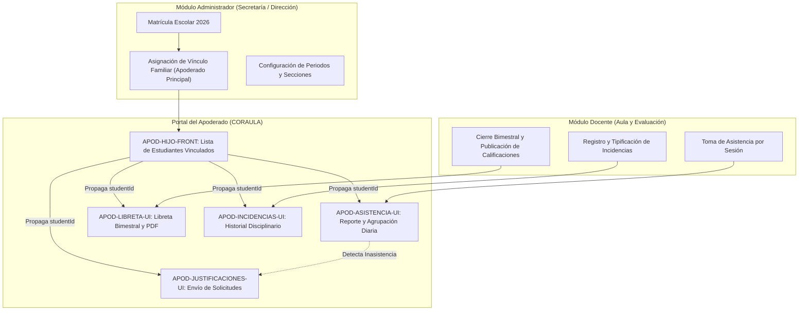

# APOD-AUDITORIA-INICIAL — Inventario Funcional del Portal Apoderado

- **Nodo:** `APOD-AUDITORIA-INICIAL`
- **Issue:** `#30`
- **Épica:** `#43`
- **Trazabilidad:** RF-26, RF-27, RF-28
- **Rama:** `feature/apoderado`
- **Fecha de Auditoría:** 30 de Octubre de 2026
- **Auditor / Rol:** Frontend Senior & Software Architect (CORAULA Engineering Team)

---

## 1. Resumen Ejecutivo

El presente documento consolida la auditoría técnica y el inventario funcional de la arquitectura del portal de **Apoderado** en el repositorio `CORAULA-FRONT`. 

El módulo ha completado la transición desde vistas estáticas iniciales basadas en datos simulados (`mocks`) hacia componentes modulares conectados a contratos oficiales de backend REST (Spring Boot) y Supabase (BaaS).

Se identificó como pilar de la arquitectura el módulo de **Estudiantes Vinculados (`APOD-HIJO-FRONT`)**, el cual actúa como proveedor de contexto para el `studentId` activo, desbloqueando el seguimiento de asistencia (`APOD-ASISTENCIA-UI`), libreta bimestral (`APOD-LIBRETA-UI`), justificaciones (`APOD-JUSTIFICACIONES-UI`) e incidencias (`APOD-INCIDENCIAS-UI`).

---

## 2. Matriz de Inventario Funcional (Diagnóstico Frontend)

| Módulo / Funcionalidad | Vista Principal | Hook / Origen de Datos | Contrato / Endpoint | Estado Actual | Trazabilidad |
| :--- | :--- | :--- | :--- | :--- | :--- |
| **Estudiantes Vinculados** | `feature/padre/vistas/estudiantes/vistaPrincipalEstudiantes.tsx` | `useApodEstudiantes` | `GET /api/v1/guardian/students` (BACK #33 / BACK #96) | **REAL** | RF-26 |
| **Asistencia Escolar** | `feature/padre/vistas/asistencia/vistaPrincipalAsistencia.tsx` | `useApodAsistencia` | `GET /api/v1/guardian/students/{id}/attendance?from=&to=` (BACK #55 / PR #112) | **REAL** | RF-26 |
| **Incidencias Disciplinarias** | `src/features/apoderado/incidencias/ApodIncidenciasView.tsx` | `useApodIncidencias` | `GET /v1/apoderado/estudiantes/{id}/incidencias` (BACK #54) | **PARCIAL / INTEGRADO** (A espera de despliegue en ambiente backend) | RF-26 |
| **Justificaciones de Inasistencia** | `feature/padre/vistas/justificaciones/vistaPrincipalJustificaciones.tsx` | `useApodJustificaciones` | Supabase DB (`justificaciones_inasistencia`) + Storage (`bucket: justificaciones`) | **PARCIAL / INTEGRADO** (Supabase BaaS) | RF-28 |
| **Libreta de Calificaciones** | `feature/padre/vistas/libreta/vistaPrincipalLibreta.tsx` | `useApodLibreta` | Supabase DB (`libreta_calificaciones`) + jsPDF / autotable | **PARCIAL / INTEGRADO** (Supabase BaaS) | RF-26, RF-31 |
| **Bandeja de Notificaciones** | `feature/padre/vistas/notificaciones/vistaPrincipalNotificaciones.tsx` | `useApodNotificaciones` | Supabase DB (`notificaciones`) | **PARCIAL / INTEGRADO** (Supabase BaaS) | RF-22, RF-27 |
| **Panel Principal (Dashboard)** | `feature/padre/vistas/pantallaPrincipal/pantallaPrincipalPadre.tsx` | `usePadre` / `getDashboardResumen` | Mocks legacy con integración progresiva | **PARCIAL** | RF-26 |
| **Mensajería Escolar** | `feature/padre/vistas/mensajeria/chatPadre.tsx` | Local State / Mock delay | Mocks legacy | **MOCK / ESTÁTICO** | N/A |

---

## 3. Mapeo de Enrutamiento (`src/app/padre/` y `src/app/apoderado/`)

### Rutas Activas Canónicas (`src/app/padre/`)
1. `/padre`: Panel general y resumen de seguimiento escolar (`src/app/padre/page.tsx`).
2. `/padre/hijos`: Mis estudiantes vinculados (`src/app/padre/hijos/page.tsx` conectado a `ApodHijoView`).
3. `/padre/estudiantes`: Alias directo para gestión familiar (`src/app/padre/estudiantes/page.tsx`).
4. `/padre/asistencia`: Control diario de asistencia por sesión y rango de fechas (`src/app/padre/asistencia/page.tsx`).
5. `/padre/libreta`: Reporte oficial y descarga en PDF de calificaciones bimestrales (`src/app/padre/libreta/page.tsx`).
6. `/padre/justificaciones`: Registro y seguimiento de justificaciones de inasistencia (`src/app/padre/justificaciones/page.tsx`).
7. `/padre/incidencias`: Historial disciplinario y gravedad de faltas (`src/app/padre/incidencias/page.tsx`).
8. `/padre/notificaciones`: Centro de alertas y avisos oficiales (`src/app/padre/notificaciones/page.tsx`).
9. `/padre/mensajeria`: Comunicación con docentes (`src/app/padre/mensajeria/page.tsx`).

### Rutas de Compatibilidad y Redirección Canónica (`src/app/apoderado/`)
- `/apoderado/asistencia` ➔ `redirect('/padre/asistencia')`
- `/apoderado/hijos` ➔ `redirect('/padre/hijos')`
- `/apoderado/estudiantes` ➔ `redirect('/padre/hijos')`
- `/apoderado/justificaciones` ➔ `redirect('/padre/justificaciones')`
- `/apoderado/libreta` ➔ `redirect('/padre/libreta')`
- `/apoderado/notificaciones` ➔ `redirect('/padre/notificaciones')`
- `/apoderado/incidencias` ➔ `redirect('/padre/incidencias')`

---

## 4. Análisis de Seguridad y Aislamiento Familiar (RF-26)

1. **Aislamiento por Token (Zero Leaks):**
   - No existen identificadores de estudiantes (`studentId`) hardcodeados en el código de producción.
   - Todas las llamadas REST a Spring Boot (`/api/v1/guardian/...`) adjuntan automáticamente el token de autorización JWT (`Bearer <token>`) mediante el interceptor de [httpClient.ts](file:///C:/Users/Nayely/CORAULA-FRONT/src/services/httpClient.ts).
   - El backend valida que el estudiante solicitado corresponda a un vínculo activo con el usuario autenticado (Regla CAB 12); en caso contrario responde con código `403 Forbidden` o `404 Not Found`.

2. **Manejo de Cuentas Sin Vínculos:**
   - Si un apoderado no tiene estudiantes vinculados para el periodo 2026, el endpoint responde `200 OK []`.
   - El frontend renderiza un estado vacío explícito ([SinEstudiantesVinculados.tsx](file:///C:/Users/Nayely/CORAULA-FRONT/feature/padre/vistas/estudiantes/components/SinEstudiantesVinculados.tsx)) informando sobre el procedimiento para asociar la matrícula en Secretaría.

3. **Guardas de Navegación y Sesión:**
   - El layout general (`src/app/padre/layout.tsx`) implementa `<AuthGuard allowedRoles={['APODERADO']}>`.
   - Si el token expira o es revocado, el interceptor de Axios despacha el evento global `auth:unauthorized`, redireccionando de inmediato al formulario de inicio de sesión.

---

## 5. Mapa de Dependencias entre Módulos

### Detalle de Dependencias Críticas
- **Dependencia de Administrador:** La existencia del estudiante en el portal requiere que Secretaría registre el vínculo familiar activo. Si no hay vínculo, el portal se bloquea en estado vacío seguro.
- **Dependencia de Docente (Asistencia):** Por regla de negocio, las sesiones no tomadas NO se muestran como presentes ni como faltas. La visualización depende enteramente de que el docente audite la sesión.
- **Dependencia de Docente (Calificaciones):** La libreta solo permite visualización y descarga en PDF si el estado del reporte bimestral figura como `isPublicado = true`.

---

## 6. Propuesta de Nodo de Trabajo Inicial (Handoff & Roadmap)

1. **Fase 1: Bloque Base — Completado:**
   - **`APOD-HIJO-FRONT`:** Resuelto y verificado. Consume `GET /api/v1/guardian/students`, administra el selector de hijos, persiste la selección en `localStorage` y la propaga a todo el árbol de componentes.
2. **Fase 2: Asistencia y Justificaciones — Completado:**
   - **`APOD-ASISTENCIA-UI`:** Resuelto y verificado. Consume `GET /api/v1/guardian/students/{id}/attendance` con validación de límite de 92 días.
   - **`APOD-JUSTIFICACIONES-UI`:** Preparado con carga de comprobantes a Supabase Storage (`justificaciones`).
3. **Fase 3: Calificaciones y Descargas — Completado:**
   - **`APOD-LIBRETA-UI`:** Resuelto y verificado. Motor de generación de PDF institucional con jsPDF y autotable.
4. **Fase 4: Incidencias y Notificaciones — Listo para Despliegue Backend:**
   - **`APOD-INCIDENCIAS-UI`:** Código frontend listo; validará contra backend tan pronto como BACK #54 esté desplegado en el cluster de staging.
   - **`APOD-NOTIFICACIONES-UI`:** Conectado a eventos de Supabase con filtrado por rol y prioridad.
